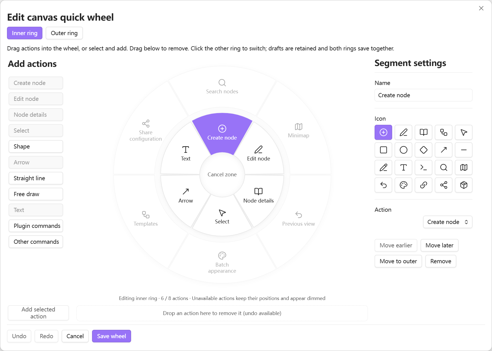
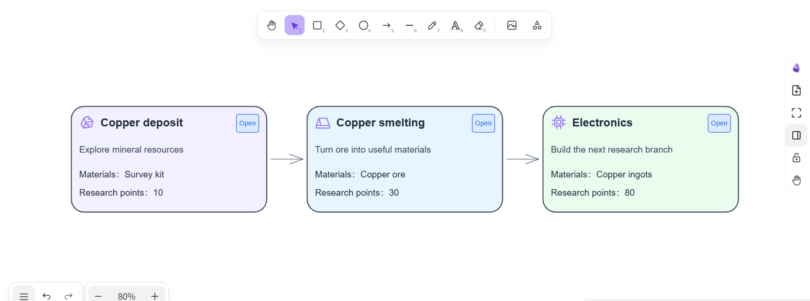
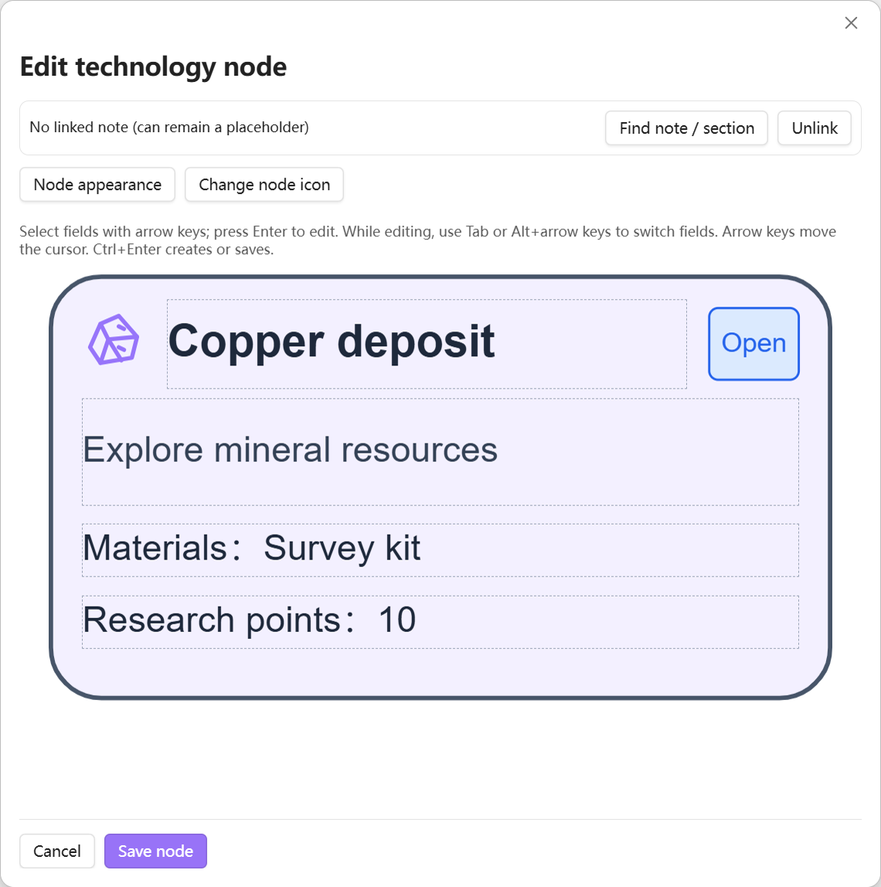
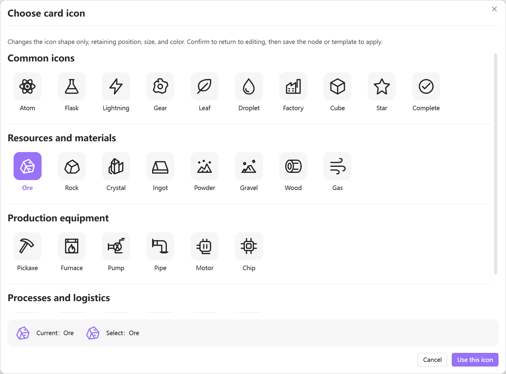

# Tech Tree Companion

[中文](README.md) | **English**

**Keep common actions beside your cursor. Build technology trees in Excalidraw.**

Tech Tree Companion extends Excalidraw in Obsidian with a customizable quick wheel, reusable SVG cards, and linked note details. Organize the overview on your canvas and keep the full design in your notes.

[Get started](#get-started) · [Interface language](#interface-language) · [Privacy and storage](docs/PRIVACY.en.md) · [Download releases](https://github.com/HWMLlv/tech-tree-companion/releases)

## A quick wheel that fits your habits

Keep frequent drawing and node actions in the inner ring. Enable an optional outer ring for navigation and management, including search, the minimap, and templates. Both rings remain customizable.

- **Hold, choose, release.** Release in the center or outside the wheel to cancel. Keyboard triggering and selection are also supported.
- **Switch rings when needed.** Press the layer key while the wheel is open—Shift by default. Configure the trigger and both ring radii in settings.
- **Edit both rings together.** Drag, reorder, rename, change icons, or move actions between rings. Switching retains both drafts; one save applies both.
- **Find actions already on the wheel.** Added actions appear dimmed in the library. Click one to select its existing segment, with a gentle icon cue.

## Optional card template picker

Enable **Creative card picker** under **Card templates** in settings to choose a template before entering the new-node editor. Standard mode still opens the original editor directly. Wide windows show seven to nine solid cards in a fan, with circular browsing, drag gestures, side-card clicks, and arrow buttons. Search and a grid view are available. The centered **Use this template** button confirms your choice; corner marks, a fine grid, and ruler ticks identify the default template. Cancel at the first step creates no node; cancel while choosing again preserves your draft.

## Cards for the overview, notes for the detail

Combine a title, summary, materials, and research points in an SVG card. Connect cards to describe prerequisites. Templates define the fields and layout, so you can develop a visual language for your own technology tree.

Link a card to a whole Markdown note or a heading section. Open its details to read and edit the linked text; double-click ordinary reading text to enter the editor. Template changes do not automatically rewrite existing cards. You choose when to apply them.

## Reusable layouts and quick icon choices

The template center supports text, fields, icons, dividers, and buttons. Common icons stay in the properties panel for quick selection; a separate picker groups the extended collection. Replacing an icon preserves its position, size, and color. Templates without an icon module need one added first.

## Stay oriented as the canvas grows

| Feature | What it helps with |
| --- | --- |
| Search and locate | Find cards in the current drawing by title, fields, template, or linked path |
| Minimap | See the layout, click to navigate, and drag to pan; visibility persists across drawings |
| Previous view | Return to an earlier canvas position and zoom, separately from file navigation history |
| Link checks | Find unavailable notes or headings, then choose replacement targets |
| Batch appearance | Preview and apply appearance or icon changes while keeping content, geometry, and links |
| Configuration sharing | Import and export templates, module presets, and wheel configuration with conflict choices |

## Get started

1. Use desktop **Obsidian 1.13.7 or later**. Separately install and enable **Excalidraw 2.25.3 or later**.
2. Search for **Tech Tree Companion** in Obsidian's community plugins, or install manually from [GitHub Releases](https://github.com/HWMLlv/tech-tree-companion/releases).
3. Open an editable Excalidraw drawing and run **Create technology node**. Fill the fields and optionally link a note.
4. Configure the quick wheel in plugin settings. Open **Template center** to adjust templates for your next cards.

Manual installation requires only `main.js`, `manifest.json`, and `styles.css` in `<vault>/<configDir>/plugins/tech-tree-companion/`. Reload Obsidian and enable the plugin. The default configuration directory is `.obsidian`; no additional runtime folder is needed. Retain `data.json`, font caches, and generated card attachments when upgrading.

Tested on Windows 11 with Obsidian 1.13.7 and Excalidraw 2.25.3. macOS and Linux have not yet been validated. **Mobile is not supported.** This independent companion relies on Excalidraw for drawing capabilities and does not install or update other plugins.

## Interface language

At the top of plugin settings, choose **Follow Obsidian / Chinese / English**. The default follows Obsidian: Chinese for Chinese locales, English otherwise. Reopen existing editor windows after switching.

This changes plugin interface text only. Saved card text, template names, custom wheel names, and notes remain unchanged. Obsidian and other plugins control their own interface languages.

## Privacy and storage

No account, advertising, analytics, or telemetry. Cards, configuration, and linked notes stay in your local vault. Versioned font shards are downloaded only when Excalidraw's Chinese handwriting glyphs are needed and are not cached; note text and paths are not uploaded.

Resource management checks local vault references to avoid recycling attachments still in use. **Scanning does not move or delete card attachments.** Recycling, recovery, and moving files to system trash are separate operations. Copy draft writes to the clipboard only when clicked.

See [Privacy, network, and local storage](docs/PRIVACY.en.md) for domains, scanning scope, triggers, and retention periods.

## Project information

- [Development and build provenance](docs/DEVELOPMENT.md)
- [Report an issue](https://github.com/HWMLlv/tech-tree-companion/issues)

Project code is [MIT licensed](LICENSE), copyright HWMLlv. Thanks to [Excalidraw](https://github.com/zsviczian/obsidian-excalidraw-plugin) and the project's open-source dependencies. Dependencies and fonts retain their own licenses; see [third-party notices](THIRD-PARTY-NOTICES.txt), the [Excalifont notice](third-party/Excalifont-font-notice.txt), and the [Xiaolai font license](third-party/Xiaolai-OFL.txt). This is not an official Obsidian or Excalidraw product.
