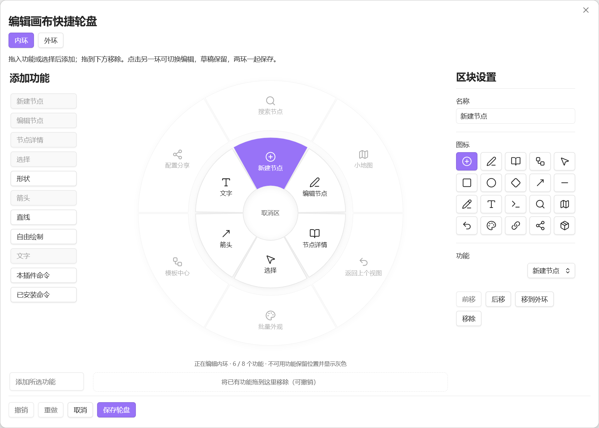
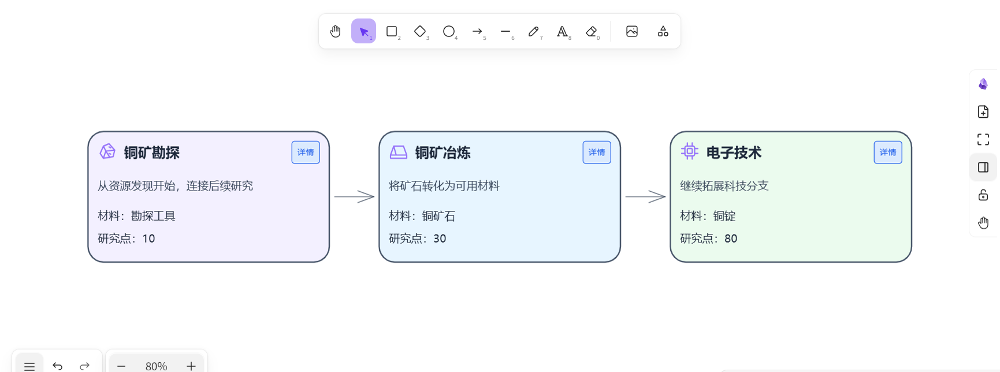
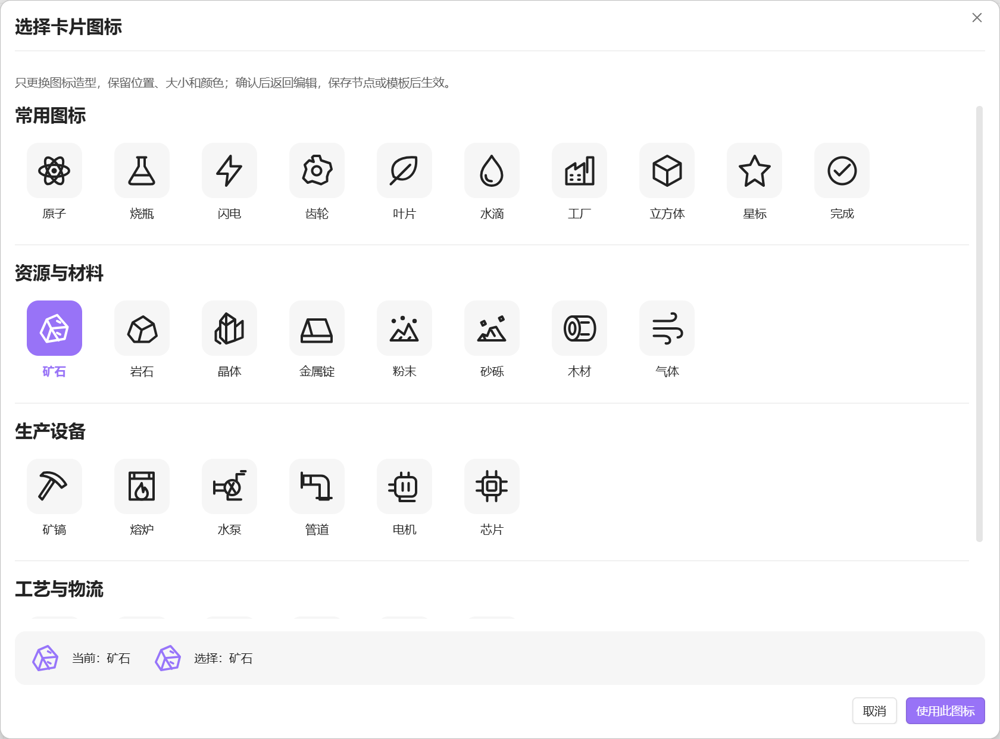

# Tech Tree Companion

**中文** | [English](README.en.md)

**把常用操作放到鼠标旁，在 Excalidraw 中组织科技树。**

Tech Tree Companion 是 Obsidian 中的 Excalidraw 辅助插件。用自定义快捷轮盘完成日常操作，用卡片和连线表达科技关系，再把卡片关联到笔记里的详细设计。

[快速开始](#快速开始) · [界面语言](#界面语言) · [隐私与存储](docs/PRIVACY.zh-CN.md) · [下载发布版](https://github.com/HWMLlv/tech-tree-companion/releases)

## 一套轮盘，保留你的操作习惯

内环放常用的绘图和节点操作；按需启用外环，放搜索、小地图、模板中心等导航与管理功能。内环仍由你自定义，外环也可以单独配置。

- **按住、选择、松开执行。** 在中心或圈外松开即可取消；也支持键盘触发和选择。
- **按需切换内外环。** 轮盘出现后按辅助层切换键，默认是 Shift；两环半径与触发方式均可调整。
- **在同一个编辑器里整理两环。** 拖入、排序、改名、换图标或跨环移动；切换时保留草稿，保存时一起保存。
- **已有功能就地定位。** 添加列表里已加入的功能只置灰；再次点击会选中轮盘上的对应位置，并给出轻微的图标提示。

## 可选的卡牌式模板选择

在设置 → 卡片模板中启用“创意卡牌选择”后，新建节点先进入模板选择，确认后再编辑；常规模式仍直接进入原编辑界面。宽窗口展示 7～9 张实色扇形卡牌，支持首尾循环、拖动拨牌、侧牌点击和左右按钮，也可搜索及切换网格。居中的“使用此模板”确认选择；默认模板带定位角、网格和刻度边框。首次取消不创建节点，编辑中的改选取消保留草稿。

## 卡片放概要，笔记放细节

把科技名称、摘要、材料和研究点组合成 SVG 卡片，再用连线组织前置关系。卡片字段和布局由模板定义，适合逐步建立自己的科技树表达方式。

卡片可以关联整篇 Markdown 笔记或一个标题章节。打开详情即可阅读和编辑关联正文；双击普通阅读文字也能进入编辑状态。模板调整不会自动改写已有卡片，由你决定何时应用。

## 外观可复用，图标快速调用

模板中心支持文字、字段、图标、分隔线和按钮模块。常用图标保留在属性栏中，更多图标在独立选择器里按类别浏览。换图标保留原有位置、尺寸与颜色；没有图标模块的模板需先添加模块。

## 图变大之后，也能找到方向

| 功能 | 用途 |
| --- | --- |
| 搜索与定位 | 在当前绘图中按名称、字段、模板或关联路径查找卡片 |
| 小地图 | 查看分布、点击定位、拖动平移；启用状态可跨绘图保留 |
| 返回上个视图 | 回到之前的画布位置与缩放，与文件历史中的“返回”区分 |
| 关联检查 | 检查笔记或章节是否仍可访问，再由你选择替换目标 |
| 批量外观 | 预览并统一选中卡片的外观或图标，保留正文、位置和关联 |
| 配置分享 | 导入导出模板、模块预设和轮盘配置，逐项处理冲突 |

## 快速开始

1. 使用桌面版 **Obsidian 1.13.7 或更高版本**，单独安装并启用 **Excalidraw 2.25.3 或更高版本**。
2. 在 Obsidian 的第三方插件中搜索 **Tech Tree Companion**；也可从 [GitHub Releases](https://github.com/HWMLlv/tech-tree-companion/releases) 下载手动安装。
3. 打开可编辑的 Excalidraw 绘图，运行 **新建科技节点**，填写字段并按需关联笔记。
4. 在插件设置中配置快捷轮盘；到 **模板中心** 调整下一批卡片使用的模板。

手动安装只需 `main.js`、`manifest.json`、`styles.css` 三个文件，放入 `<仓库>/<配置目录>/plugins/tech-tree-companion/`，重新加载后启用插件。默认配置目录为 `.obsidian`，无需额外的运行时文件夹。升级时保留 `data.json`、字体缓存和生成的卡片附件。

当前实机验证环境为 Windows 11、Obsidian 1.13.7 与 Excalidraw 2.25.3；macOS、Linux 尚未完成验证，**暂不支持移动端**。本插件是独立辅助项目，依赖 Excalidraw 提供绘图能力；不会自动安装或更新其他插件。

## 界面语言

插件设置顶部提供 **跟随 Obsidian / 中文 / English**，默认跟随 Obsidian；中文环境使用中文，其他语言环境使用英文。切换后重新打开已有编辑窗口即可更新显示。

语言设置只作用于插件界面。已保存的卡片文字、模板名称、轮盘自定义名称和笔记内容保持原样；Obsidian 与其他插件的界面语言由它们自己的设置控制。

## 隐私与存储

无需账户，无广告、分析统计或遥测。卡片、配置与关联笔记保存在本地仓库。仅在使用 Excalidraw 的中文手写字形且缺少缓存时，下载所需的版本化字体分片；不上传笔记正文或路径。

资源管理会在本地扫描仓库引用，避免误回收仍在使用的附件。**扫描本身不移动或删除卡片附件**；回收、恢复和移至系统回收站是独立操作。点击“复制草稿”才会写入剪贴板。

完整的联网域名、扫描范围、触发条件和保留期见 [隐私与本地存储说明](docs/PRIVACY.zh-CN.md)。

## 文档与项目

- [中文使用指南](USER-GUIDE.zh-CN.md)
- [开发与构建来源说明（English）](docs/DEVELOPMENT.md)
- [反馈问题](https://github.com/HWMLlv/tech-tree-companion/issues)

项目代码使用 [MIT 许可证](LICENSE)，版权归 HWMLlv 所有。感谢 [Excalidraw](https://github.com/zsviczian/obsidian-excalidraw-plugin) 及相关开源依赖。依赖与字体遵循各自许可证，详见 [第三方声明](THIRD-PARTY-NOTICES.txt)、[Excalifont 声明](third-party/Excalifont-font-notice.txt) 与 [Xiaolai 字体许可](third-party/Xiaolai-OFL.txt)。本项目不是 Obsidian 或 Excalidraw 的官方产品。
